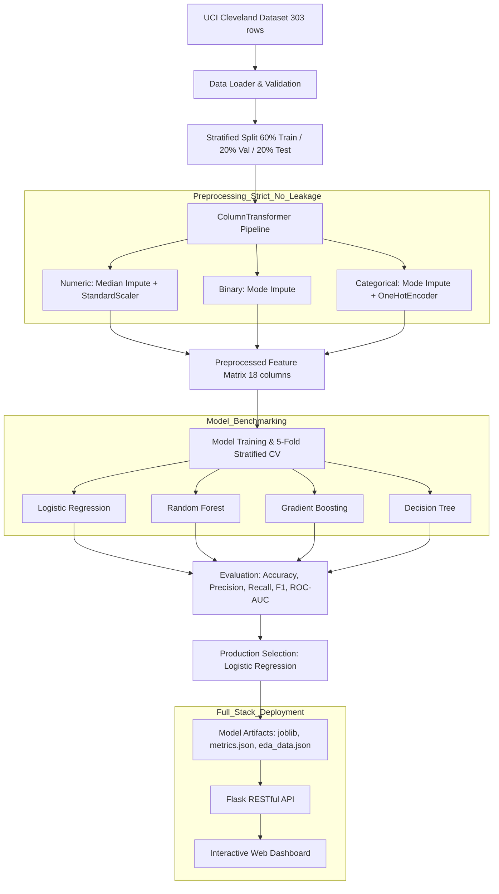

# Heart Disease Risk Predictor (Student Machine Learning Project)

[](https://www.python.org/)
[](https://scikit-learn.org/)
[](https://flask.palletsprojects.com/)
[]()

> **Student Machine Learning Project**: A simple, easy-to-understand machine learning project to predict heart disease risk using health checkup records from the Cleveland Heart dataset.

---

## 1. Project Overview & Goals

Heart disease is one of the leading health problems worldwide. Catching heart issues early using simple, non-invasive health checks (like age, blood pressure, cholesterol, and basic heart monitoring) can help people take action before serious complications occur.

This project implements an end-to-end machine learning system that:
1. **Finds Data Patterns**: Discovers patterns connecting health checks (such as exercise test results, chest pain, and blocked arteries) to heart disease risk.
2. **Trains and Compares 4 ML Models**: Compares Logistic Regression, Random Forest, Gradient Boosting, and Decision Tree models using **5-Fold Cross-Validation**.
3. **Groups Risk into Simple Tiers**: Groups patient results into three easy-to-understand risk levels—**Low Risk** ($P < 0.35$), **Medium Risk** ($0.35 \le P < 0.65$), and **High Risk** ($P \ge 0.65$).
4. **Provides an Interactive Web App**: Features single-patient risk checks with quick example presets, drag-and-drop batch CSV testing, simple data charts, and model comparison scoreboards.

---

## 2. Dataset Selection & Feature Guide

### Dataset: Cleveland Heart Disease Dataset
- **Source**: [UCI Machine Learning Repository — Heart Disease](https://archive.ics.uci.edu/dataset/45/heart+disease)
- **Institution**: Cleveland Clinic Foundation
- **Records**: 303 patient records
- **Features**: 13 health attributes + 1 goal prediction label (`target`)
- **Balance**: 164 Healthy (54.1%) vs. 139 Heart Disease (45.9%) — nicely balanced data.

### Simple Feature Guide (Student Cheatsheet)

| # | Feature Name | Column | Type | Values / Range | What It Means (Simple Words) |
|---|--------------|--------|------|----------------|------------------------------|
| 1 | Age | `age` | Number | 29 – 77 years | Heart risk increases naturally as people get older. |
| 2 | Gender | `sex` | Yes/No | 0 = Female, 1 = Male | Men in this dataset showed earlier signs of heart disease. |
| 3 | Chest Pain Type | `cp` | Category | 1: Typical, 2: Unusual, 3: Non-heart, 4: No pain | Type of chest pain felt. Interestingly, patients with no pain (type 4) often had hidden severe issues. |
| 4 | Resting Blood Pressure | `trestbps` | Number | 94 – 200 mm Hg | High blood pressure puts extra wear and strain on blood vessels. |
| 5 | Cholesterol Level | `chol` | Number | 126 – 564 mg/dL | High cholesterol can cause fatty buildup in heart vessels. |
| 6 | Fasting Blood Sugar | `fbs` | Yes/No | 0: Normal, 1: High (> 120 mg/dL) | Checks for diabetes or high blood sugar, which strains the heart. |
| 7 | Resting Heart Monitor (ECG) | `restecg` | Category | 0: Normal, 1: Unusual wave, 2: Thick heart muscle | Quick electrical recording of the heartbeat while resting quietly. |
| 8 | Maximum Heart Rate | `thalach` | Number | 71 – 202 bpm | Highest heart rate achieved during exercise test. Lower peak rate can mean heart weakness. |
| 9 | Chest Pain from Exercise | `exang` | Yes/No | 0 = No, 1 = Yes | Did exercise trigger chest discomfort? If yes, heart may lack oxygen during stress. |
| 10 | Heart Stress Wave Dip | `oldpeak` | Number | 0.0 – 6.2 mm | How much the ECG wave dips during hard exercise. Larger dips indicate heart strain. |
| 11 | Heart Wave Slope | `slope` | Category | 1: Sloping up (healthy), 2: Flat, 3: Sloping down | The direction the ECG wave curve points during hard exercise. |
| 12 | Blocked Vessels Count | `ca` | Number | 0 – 3 vessels | Number of major arteries showing blockages on an X-ray scan. |
| 13 | Heart Blood Flow Scan | `thal` | Category | 3: Normal flow, 6: Permanent issue (old scar), 7: Temporary issue | Scan showing if blood flows properly to all areas of the heart. |
| 🎯 | Prediction Target | `target` | Goal | 0: Healthy / No Disease, 1: Heart Disease Detected | What our machine learning models are trained to predict. |

---

## 3. System Architecture & Methodology



### Prevention of Data Leakage
- **Split First**: The dataset is partitioned into 60% Train, 20% Validation, and 20% Test using stratified splitting **prior** to any data transformation.
- **Fit on Train Only**: All scalers, imputers, and encoders are fit **exclusively** on the training partition.
- **Hold-out Test Set**: The 20% test partition (61 patients) is evaluated **only once** for final reporting.

---

## 4. Experimental Results & Model Comparison

### 5-Fold Stratified Cross-Validation Benchmark (Training Cohort)

| Model | CV Accuracy | CV Precision | CV Sensitivity (Recall) | CV F1-Score | CV ROC-AUC | Selected |
|-------|-------------|--------------|-------------------------|-------------|------------|:--------:|
| **Logistic Regression** | **82.9%** | **83.1%** | **79.5%** | **80.9%** | **89.3%** | 🏆 **Yes** |
| **Random Forest** | 79.6% | 81.5% | 74.8% | 77.2% | 88.0% | No |
| **Gradient Boosting** | 74.6% | 73.8% | 74.8% | 72.9% | 85.3% | No |
| **Decision Tree** | 71.3% | 71.9% | 65.2% | 67.5% | 70.8% | No |

### Final Hold-Out Test Set Performance (Logistic Regression)
- **Test Accuracy**: **86.9%** (53 / 61 correct)
- **Test Precision**: **81.3%**
- **Test Sensitivity (Recall)**: **92.9%** (26 of 28 positive cases correctly identified)
- **Test F1-Score**: **86.7%**
- **Test ROC-AUC**: **91.9%**

### Why We Chose Logistic Regression (Student Presentation Points)
1. **High Catch Rate (Recall 92.9%)**: In health screenings, it is most important not to miss anyone who might have heart disease. The model correctly identified 26 out of 28 disease cases.
2. **Clear Probability Percentages**: Logistic regression naturally produces clean probabilities (e.g., 26% risk, 85% risk) which make it easy to group patients into Low, Medium, or High risk.
3. **Easy to Explain**: Unlike complicated black-box algorithms, Logistic Regression provides clear weights for each test factor so any student can explain why a prediction was made.

---

## 5. Simple Risk Levels Explained

The predicted disease probability $P(\text{disease})$ is translated into 3 easy-to-understand categories:

| Risk Level | Risk Range | What It Means (Simple Words) |
|------------|------------|------------------------------|
| 🟢 **Low Risk** | Under 35% | Most health signs are in normal ranges. Healthy routine habits recommended. |
| 🟡 **Medium Risk** | 35% to 65% | Borderline health readings. A doctor may suggest re-checking tests or lifestyle changes. |
| 🔴 **High Risk** | Above 65% | Several high-risk indicators detected (e.g., high stress wave dip, blocked arteries). Doctor review advised. |

---

## 6. Project Directory Layout

```
health/
├── data/
│   └── heart.csv                       # Verified UCI Cleveland dataset (303 rows)
├── models/
│   ├── best_model.joblib               # Fitted production Logistic Regression model
│   ├── preprocessing_pipeline.joblib   # Fitted scikit-learn ColumnTransformer
│   ├── all_models.joblib               # Serialized models dictionary for comparison
│   ├── metrics.json                    # Detailed CV & Test evaluation metrics
│   └── eda_data.json                   # Aggregated statistics for dynamic frontend charts
├── src/
│   ├── __init__.py
│   ├── data_loader.py                  # Dataset loading, schema validation, data dictionaries
│   ├── data_preprocessing.py           # Preprocessing pipeline, imputation, encoding, scaling
│   ├── exploratory_analysis.py         # Pattern mining, K-Means clustering, PCA, 8 plot generators
│   ├── train_model.py                  # 4 ML models training & 5-fold cross-validation
│   ├── evaluate_model.py               # Confusion matrices, ROC curves, PR curves, importance
│   └── predict.py                      # Single & batch prediction engine with risk categorization
├── backend/
│   ├── __init__.py
│   ├── app.py                          # Flask application factory
│   └── routes.py                       # RESTful API endpoints
├── frontend/
│   ├── index.html                      # Modern UI dashboard with tabs & presets
│   ├── style.css                       # High-tech medical glassmorphism aesthetic
│   └── script.js                       # Asynchronous API integration & interactive logic
├── static/
│   └── plots/                          # 13 high-resolution visualization plots (PNG)
├── tests/
│   ├── __init__.py
│   ├── test_preprocessing.py           # Tests for data loading, no-leakage split, transformer
│   ├── test_prediction.py              # Tests for prediction, validation, thresholds, batch
│   └── test_api.py                     # Integration tests for Flask REST endpoints
├── requirements.txt                    # Python dependencies
├── run_pipeline.py                     # End-to-end master execution pipeline
└── README.md                           # Complete project documentation
```

---

## 7. Installation & Quick Start

### 1. Prerequisites & Environment Setup
Clone the repository and install required packages in a Python 3.10+ virtual environment:
```bash
pip install -r requirements.txt
```

### 2. Run the End-to-End Pipeline
Re-execute dataset validation, preprocessing, EDA plot generation, model training, and evaluation with a single command:
```bash
python run_pipeline.py
```

### 3. Run the Automated Test Suite
Verify that all 17 unit and integration tests pass:
```bash
python -m unittest discover tests
```

### 4. Launch the Web Application
Start the Flask server:
```bash
python -m backend.app
```
Open your web browser and navigate to:
```
http://127.0.0.1:5000
```

---

## 8. RESTful API Reference

| Method | Endpoint | Description | Payload / Response |
|--------|----------|-------------|-------------------|
| `GET` | `/` | Web dashboard | HTML5 / CSS / JS |
| `GET` | `/api/health` | Health and model readiness check | `{"status": "healthy", "model_loaded": true}` |
| `GET` | `/api/dataset-info` | Dataset summary and clinical feature schema | Record counts, feature dictionary, summary stats |
| `GET` | `/api/model-info` | Model cross-validation & test benchmarks | Comprehensive metrics for all 4 models |
| `GET` | `/api/eda` | EDA statistics and plot file references | List of generated PNG plots and summary metrics |
| `GET` | `/api/feature-importance` | Feature weights / model coefficients | Ranked feature list with absolute importance |
| `POST` | `/api/predict` | Single patient clinical risk calculation | Input: 13 features JSON<br>Output: probability, category, label |
| `POST` | `/api/predict-csv` | Batch patient risk screening | Input: multipart CSV file<br>Output: risk distributions and row predictions |

---

## 9. Ethical Considerations & Medical Disclaimer

> **IMPORTANT CLINICAL & LEGAL DISCLAIMER**
> 
> This application and its underlying machine learning models were developed strictly for **academic, research, and educational purposes**.
> 
> - The model was trained on historical patient records collected in the 1980s at the Cleveland Clinic Foundation.
> - The risk scores and categorization represent **statistical associations**, not clinical diagnoses.
> - This software is **NOT certified as a medical device** (FDA/CE) and must **never** be used to alter, replace, or inform actual clinical patient management or medication prescriptions.
> - Always consult a licensed and qualified medical professional for health assessments and cardiovascular diagnosis.
