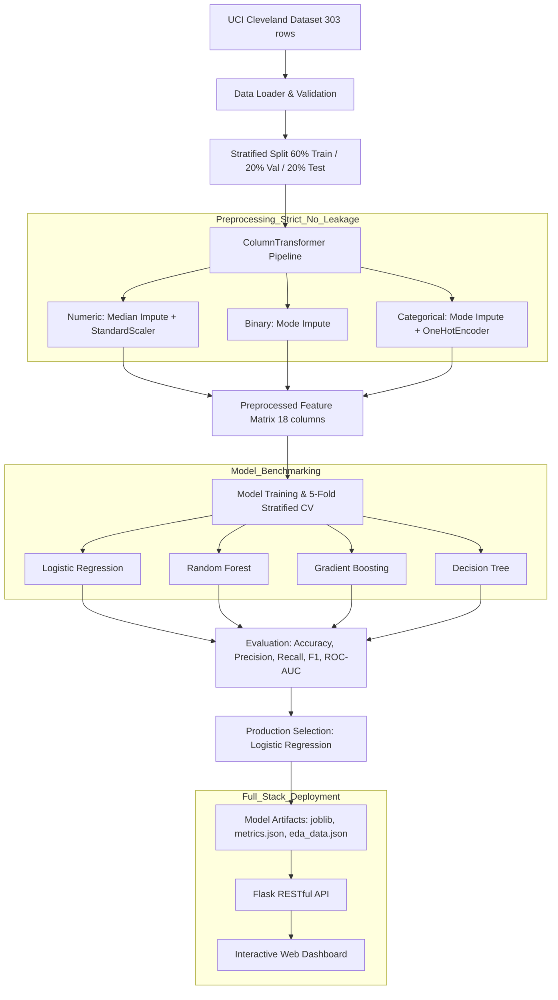

# Healthcare Patient Risk Pattern Mining Using Machine Learning

[](https://www.python.org/)
[](https://scikit-learn.org/)
[](https://flask.palletsprojects.com/)
[]()

> **Academic Machine Learning Project**: An end-to-end clinical pattern mining and cardiovascular risk prediction platform designed for university academic evaluation.

---

## 1. Project Overview & Clinical Objective

Coronary heart disease remains one of the primary contributors to global cardiovascular morbidity and mortality. Early detection and risk stratification through non-invasive clinical and demographic parameters provide healthcare practitioners with diagnostic decision-support prior to invasive angiography.

This project implements an end-to-end machine learning system that:
1. **Mines clinical patterns**: Identifies non-linear correlations and groupings among diagnostic attributes (e.g., ST depression, fluoroscopy major vessel opacification, chronotropic incompetence).
2. **Trains and benchmarks 4 ML algorithms**: Compares Logistic Regression, Random Forest, Gradient Boosting, and Decision Trees using **5-Fold Stratified Cross-Validation**.
3. **Calibrates probabilistic risk tiers**: Groups patients into statistical categories—**Low Risk** ($P < 0.35$), **Moderate Risk** ($0.35 \le P < 0.65$), and **High Risk** ($P \ge 0.65$).
4. **Delivers a production-grade full-stack dashboard**: Features single-patient risk estimation with clinical presets, high-throughput drag-and-drop batch CSV screening, an interactive EDA plot gallery, and model diagnostic curves.

---

## 2. Dataset Selection & Clinical Dictionary

### Dataset: UCI Cleveland Heart Disease Database
- **Source**: [UCI Machine Learning Repository — Heart Disease](https://archive.ics.uci.edu/dataset/45/heart+disease)
- **Institution**: Cleveland Clinic Foundation (Dr. Robert Detrano)
- **Instances**: 303 patient records
- **Features**: 13 diagnostic/demographic attributes + 1 binary target
- **Target Distribution**: 164 No Heart Disease (54.1%) vs. 139 Disease Present (45.9%) — balanced, avoiding severe class imbalance pitfalls.

### Clinical Feature Dictionary

| # | Attribute | Code | Type | Permissible Range / Values | Medical Significance |
|---|-----------|------|------|---------------------------|----------------------|
| 1 | Age | `age` | Numeric | 29 – 77 years | Advancing age is a non-modifiable cardiovascular risk factor. |
| 2 | Sex | `sex` | Binary | 0 = Female, 1 = Male | Hormonal differences and typical CAD presentation timing. |
| 3 | Chest Pain Type | `cp` | Categorical | 1: Typical Angina, 2: Atypical, 3: Non-Anginal, 4: Asymptomatic | Asymptomatic chest pain frequently signals silent ischemia in advanced stenosis. |
| 4 | Resting Blood Pressure | `trestbps` | Numeric | 94 – 200 mm Hg | Elevated vascular resistance causing arterial stiffening. |
| 5 | Serum Cholesterol | `chol` | Numeric | 126 – 564 mg/dL | Circulating lipid levels contributing to atherosclerotic plaque. |
| 6 | Fasting Blood Sugar | `fbs` | Binary | 0: $\le 120$ mg/dL, 1: $> 120$ mg/dL | Surrogate indicator of metabolic disorder/diabetes. |
| 7 | Resting ECG | `restecg` | Categorical | 0: Normal, 1: ST-T wave anomaly, 2: LV Hypertrophy | Detects electrical conduction defects and ventricular strain. |
| 8 | Maximum Heart Rate | `thalach` | Numeric | 71 – 202 bpm | Chronotropic incompetence (inability to reach expected HR). |
| 9 | Exercise Induced Angina | `exang` | Binary | 0 = No, 1 = Yes | Myocardial hypoxia induced under physiological stress. |
| 10 | ST Depression | `oldpeak` | Numeric | 0.0 – 6.2 mm | Exercise-induced ST depression relative to resting baseline. |
| 11 | ST Slope | `slope` | Categorical | 1: Upsloping, 2: Flat, 3: Downsloping | Flat or downsloping ST segments denote severe ischemia. |
| 12 | Major Vessels Colored | `ca` | Numeric | 0 – 3 vessels | Number of major coronary arteries opacified by fluoroscopy. |
| 13 | Thalassemia Scintigraphy | `thal` | Categorical | 3: Normal, 6: Fixed defect, 7: Reversible defect | Nuclear imaging revealing areas of transient or permanent ischemic damage. |
| 🎯 | Disease Diagnosis | `target` | Binary | 0: No Disease, 1: Disease Present ($>50\%$ vessel diameter narrowing) | Supervised classification label. |

---

## 3. System Architecture & Methodology



### Prevention of Data Leakage
- **Split First**: The dataset is partitioned into 60% Train, 20% Validation, and 20% Test using stratified splitting **prior** to any data transformation.
- **Fit on Train Only**: All scalers, imputers, and encoders are fit **exclusively** on the training partition.
- **Hold-out Test Set**: The 20% test partition (61 patients) is evaluated **only once** for final reporting.

---

## 4. Experimental Results & Model Comparison

### 5-Fold Stratified Cross-Validation Benchmark (Training Cohort)

| Model | CV Accuracy | CV Precision | CV Sensitivity (Recall) | CV F1-Score | CV ROC-AUC | Selected |
|-------|-------------|--------------|-------------------------|-------------|------------|:--------:|
| **Logistic Regression** | **82.9%** | **83.1%** | **79.5%** | **80.9%** | **89.3%** | 🏆 **Yes** |
| **Random Forest** | 79.6% | 81.5% | 74.8% | 77.2% | 88.0% | No |
| **Gradient Boosting** | 74.6% | 73.8% | 74.8% | 72.9% | 85.3% | No |
| **Decision Tree** | 71.3% | 71.9% | 65.2% | 67.5% | 70.8% | No |

### Final Hold-Out Test Set Performance (Logistic Regression)
- **Test Accuracy**: **86.9%** (53 / 61 correct)
- **Test Precision**: **81.3%**
- **Test Sensitivity (Recall)**: **92.9%** (26 of 28 positive cases correctly identified)
- **Test F1-Score**: **86.7%**
- **Test ROC-AUC**: **91.9%**

### Healthcare Rationale for Model Selection
1. **High Clinical Recall (92.9%)**: In cardiovascular triage, false negatives (failing to identify an ischemic patient) are significantly more dangerous than false positives.
2. **Calibrated Probabilities**: Logistic regression directly yields well-calibrated posterior probabilities, allowing dependable risk categorization.
3. **Interpretability**: Medical systems require explainable feature weights (e.g. odds ratios) rather than opaque black-box decisions.

---

## 5. Statistical Risk Categorization

The predicted disease probability $P(\text{disease})$ is mapped to statistical risk categories derived from model calibration:

| Risk Category | Probability Range | Clinical Action / Interpretation |
|---------------|-------------------|----------------------------------|
| 🟢 **Low Risk** | $P < 0.35$ | Model indicates low statistical likelihood of CAD. Regular wellness checkups recommended. |
| 🟡 **Moderate Risk** | $0.35 \le P < 0.65$ | Indeterminate or borderline likelihood. Stress echocardiography or functional testing advised. |
| 🔴 **High Risk** | $P \ge 0.65$ | High statistical likelihood. Priority referral for cardiological consultation and invasive angiography. |

---

## 6. Project Directory Layout

```
health/
├── data/
│   └── heart.csv                       # Verified UCI Cleveland dataset (303 rows)
├── models/
│   ├── best_model.joblib               # Fitted production Logistic Regression model
│   ├── preprocessing_pipeline.joblib   # Fitted scikit-learn ColumnTransformer
│   ├── all_models.joblib               # Serialized models dictionary for comparison
│   ├── metrics.json                    # Detailed CV & Test evaluation metrics
│   └── eda_data.json                   # Aggregated statistics for dynamic frontend charts
├── src/
│   ├── __init__.py
│   ├── data_loader.py                  # Dataset loading, schema validation, data dictionaries
│   ├── data_preprocessing.py           # Preprocessing pipeline, imputation, encoding, scaling
│   ├── exploratory_analysis.py         # Pattern mining, K-Means clustering, PCA, 8 plot generators
│   ├── train_model.py                  # 4 ML models training & 5-fold cross-validation
│   ├── evaluate_model.py               # Confusion matrices, ROC curves, PR curves, importance
│   └── predict.py                      # Single & batch prediction engine with risk categorization
├── backend/
│   ├── __init__.py
│   ├── app.py                          # Flask application factory
│   └── routes.py                       # RESTful API endpoints
├── frontend/
│   ├── index.html                      # Modern UI dashboard with tabs & presets
│   ├── style.css                       # High-tech medical glassmorphism aesthetic
│   └── script.js                       # Asynchronous API integration & interactive logic
├── static/
│   └── plots/                          # 13 high-resolution visualization plots (PNG)
├── tests/
│   ├── __init__.py
│   ├── test_preprocessing.py           # Tests for data loading, no-leakage split, transformer
│   ├── test_prediction.py              # Tests for prediction, validation, thresholds, batch
│   └── test_api.py                     # Integration tests for Flask REST endpoints
├── requirements.txt                    # Python dependencies
├── run_pipeline.py                     # End-to-end master execution pipeline
└── README.md                           # Complete project documentation
```

---

## 7. Installation & Quick Start

### 1. Prerequisites & Environment Setup
Clone the repository and install required packages in a Python 3.10+ virtual environment:
```bash
pip install -r requirements.txt
```

### 2. Run the End-to-End Pipeline
Re-execute dataset validation, preprocessing, EDA plot generation, model training, and evaluation with a single command:
```bash
python run_pipeline.py
```

### 3. Run the Automated Test Suite
Verify that all 17 unit and integration tests pass:
```bash
python -m unittest discover tests
```

### 4. Launch the Web Application
Start the Flask server:
```bash
python -m backend.app
```
Open your web browser and navigate to:
```
http://127.0.0.1:5000
```

---

## 8. RESTful API Reference

| Method | Endpoint | Description | Payload / Response |
|--------|----------|-------------|-------------------|
| `GET` | `/` | Web dashboard | HTML5 / CSS / JS |
| `GET` | `/api/health` | Health and model readiness check | `{"status": "healthy", "model_loaded": true}` |
| `GET` | `/api/dataset-info` | Dataset summary and clinical feature schema | Record counts, feature dictionary, summary stats |
| `GET` | `/api/model-info` | Model cross-validation & test benchmarks | Comprehensive metrics for all 4 models |
| `GET` | `/api/eda` | EDA statistics and plot file references | List of generated PNG plots and summary metrics |
| `GET` | `/api/feature-importance` | Feature weights / model coefficients | Ranked feature list with absolute importance |
| `POST` | `/api/predict` | Single patient clinical risk calculation | Input: 13 features JSON<br>Output: probability, category, label |
| `POST` | `/api/predict-csv` | Batch patient risk screening | Input: multipart CSV file<br>Output: risk distributions and row predictions |

---

## 9. Ethical Considerations & Medical Disclaimer

> **IMPORTANT CLINICAL & LEGAL DISCLAIMER**
> 
> This application and its underlying machine learning models were developed strictly for **academic, research, and educational purposes**.
> 
> - The model was trained on historical patient records collected in the 1980s at the Cleveland Clinic Foundation.
> - The risk scores and categorization represent **statistical associations**, not clinical diagnoses.
> - This software is **NOT certified as a medical device** (FDA/CE) and must **never** be used to alter, replace, or inform actual clinical patient management or medication prescriptions.
> - Always consult a licensed and qualified medical professional for health assessments and cardiovascular diagnosis.
